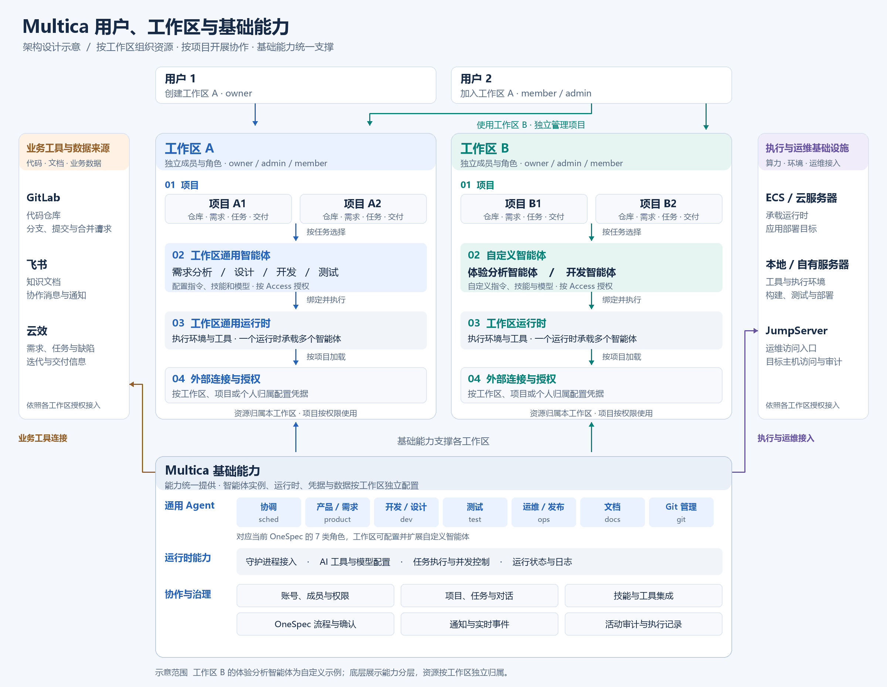

# OneSpec 内置智能体与工作区运行时配置需求

| 项目 | 内容 |
| --- | --- |
| 文档状态 | 已确认并完成本地实现 |
| 整理日期 | 2026-11-13 |
| 需求来源 | 本次关于用户、工作区、项目、OneSpec 智能体和运行时的讨论 |
| 代码基线 | 当前本地工作区，包含未提交的开发内容 |
| 验证范围 | 本地数据库与相关前后端测试；浏览器端到端及真实智能体执行待验收 |

## 1. 背景与目标

系统已具备账号、工作区、项目、自定义智能体、运行时、OneSpec 流程与默认团队初始化能力。当前使用 OneSpec 时，需要先配置可用运行时，再从项目中初始化团队。新用户创建独立工作区后，需要自行完成这些准备工作。

本次需求将 OneSpec 通用智能体作为系统内置能力提供。创建工作区时自动启用内置角色，为该工作区建立独立配置实例。用户可以先创建项目、整理需求，再配置执行环境。用户明确选择 OneSpec 后，项目自动继承工作区默认运行时并绑定通用团队。新项目的 OneSpec 开关默认关闭。

目标包括降低首次配置成本，让团队成员复用工作区执行资源，并让个人用户能够在独立工作区配置自己的执行环境。

## 2. 已确认的架构边界

1. 用户账号属于整套系统，同一用户可加入多个工作区，在各工作区分别获得成员身份和角色。
2. 一个工作区包含多个项目。成员权限、智能体实例、运行时、凭据和业务数据按工作区归属。
3. 工作区内的多个项目可按授权使用通用智能体和运行时。
4. 平台统一提供 OneSpec 角色定义、默认指令和技能规则，工作区启用后形成独立配置实例。
5. 项目可继承工作区默认运行时，也可选择本工作区内获得授权的专用运行时。
6. 用户可使用自己接入的运行时，也可使用本工作区内获得授权的其他成员运行时。
7. 创建项目允许暂缺运行时。智能体开始实际执行前，必须具备有效绑定与执行授权。

[可编辑架构图](../assets/architecture/multica-workspace-architecture.svg)

图中底部表达平台提供的基础能力。运行实例和业务数据分别归属工作区。工作区 B 的体验分析智能体是自定义场景示例。两侧外部系统表达整体接入位置，具体接入能力需要逐项验证。

## 3. 概念定义

| 概念 | 定义 |
| --- | --- |
| 内置智能体定义 | 系统维护的角色标识、默认指令和技能规则 |
| 工作区启用关系 | 某个工作区启用某类内置智能体的关系，可在运行时尚未配置时建立 |
| 工作区智能体实例 | 承载该工作区的配置、访问授权、运行时绑定和执行记录的具体对象 |
| 工作区默认运行时 | 工作区管理员选择的默认执行环境，供项目继承 |
| 项目专用运行时 | 项目明确选择的执行环境，优先于工作区默认值 |
| 项目团队绑定 | 项目中的角色与具体智能体实例、运行时之间的映射 |
| 运行时所有者 | 接入并拥有该执行资源的账号，负责授权资源使用范围 |

产品界面使用“启用 OneSpec 团队”“配置运行时”“使用工作区默认值”等表达。后台可通过创建实例和关联内置角色实现启用关系，具体数据模型由详细设计确定。

## 4. 当前能力与本次增量

| 能力 | 当前代码情况 | 本次目标 |
| --- | --- | --- |
| 七类 OneSpec 角色 | 已有角色标识、默认指令和技能规则 | 复用既有定义 |
| 默认团队初始化 | 项目内触发，要求先配置运行时 | 支持工作区创建时自动启用 |
| 团队实例复用 | 按工作区、运行时和系统角色查找或创建 | 支持待配置状态，并保持复用和隔离语义 |
| 工作区默认运行时 | 已有设置页面与后端接口 | 与智能体绑定状态衔接 |
| 项目运行时覆盖 | 已支持项目指定值和工作区默认值 | 创建项目时自动完成适用的团队绑定 |
| 普通项目创建 | 运行时并非必填 | 支持后续配置与明确引导 |
| 运行时共享 | 支持工作区公开、指定成员、私有 | 沿用所有者授权，展示不可用原因 |
| 自定义智能体 | 已有创建和配置能力 | 与内置团队并存，支持项目明确选择 |

当前项目角色模型还包含安全角色 `sec`。现有 OneSpec 一键初始化包含下表七类角色，本次默认团队沿用这个范围。

## 5. 内置 OneSpec 角色

| 标识 | 展示名称 | 主要职责 |
| --- | --- | --- |
| `sched` | 协调智能体 | 协调阶段推进，按已确认计划组织执行 |
| `product` | 产品与需求智能体 | 澄清需求，整理 PRD、原型与验收条件 |
| `dev` | 开发与设计智能体 | 详细设计、任务拆解、开发和变更归档 |
| `test` | 测试智能体 | 按已确认需求验证交付，记录测试证据 |
| `ops` | 运维与发布智能体 | 发布准备、环境检查和授权后的部署执行 |
| `docs` | 文档智能体 | 更新项目文档并关联来源任务与提交 |
| `git` | Git 管理智能体 | 分支、提交、发布与合并流程管理 |

## 6. 用户场景

### 6.1 团队工作区

用户 A 创建工作区，系统自动启用 OneSpec 团队。A 接入执行环境，设置合适的工作区使用权限并配置默认运行时。成员 B 接受邀请加入该工作区，创建项目并选择 OneSpec 后，继承默认运行时与团队配置。

### 6.2 个人工作区

用户 B 创建自己的工作区，系统自动启用该工作区的 OneSpec 团队。B 可以先创建项目，随后接入自己的电脑或服务器。配置完成后，项目能够使用相应智能体执行任务。

### 6.3 项目专用环境

项目 A1 使用工作区默认运行时。项目 A2 因工具或环境需要，选择另一个已授权运行时。A2 的绑定变更应仅作用于其对应配置，A1 的执行绑定继续按自身配置解析。

### 6.4 自定义智能体

工作区 B 可以创建体验分析智能体和开发智能体，并用于对话、任务或适用的项目角色。内置团队初始化需要识别已有配置，自动补齐默认配置时保留用户明确选择的自定义绑定。

## 7. 功能需求

### FR-01 工作区自动启用团队

- 工作区创建成功后，自动启用七类 OneSpec 角色。
- 运行时暂缺时，用户仍可查看角色、职责和配置状态。
- 启用关系与实例能够关联到对应内置角色，支持后续补齐和识别。
- 初始化失败需要显示可理解的状态与重试入口。
- 重复请求、并发触发和失败重试应收敛到同一套有效启用关系。

### FR-02 运行时配置与授权

- 工作区 owner、admin 可配置工作区默认运行时。
- 候选运行时必须属于当前工作区，并满足当前配置操作所需授权。
- 运行时所有者决定使用范围。工作区默认值设置本身不产生新的资源授权。
- 智能体 Access 与运行时授权分别校验，绑定和执行沿用明确的授权路径。
- 私有、指定成员和工作区公开运行时应在界面中展示清楚。
- 默认值已设置但无法使用时，界面应显示原因和可执行的处理入口。

### FR-03 选择 OneSpec 后自动绑定

- 新项目默认关闭 OneSpec，用户明确选择后自动绑定内置通用智能体。
- 创建项目时允许保留“使用工作区默认值”。
- 有可用默认运行时时，为适用的 OneSpec 项目自动补齐默认团队绑定。
- 选择项目专用运行时时，使用该运行时建立对应团队绑定。
- 缺少运行时时，项目可创建成功，团队显示待配置状态。
- 保存运行时配置后，应完成待配置项目的适用绑定，并展示结果。
- 已有显式自定义角色配置优先保留，冲突需显示并由用户选择处理。

### FR-04 运行时解析与一致性

初始化默认团队时，按以下顺序确定运行时。

1. 项目显式配置的运行时。
2. 工作区默认运行时。
3. 两者均缺失时进入待配置状态。

该顺序用于解析默认团队配置。实际执行需要校验已选智能体实例的真实运行时绑定，项目角色记录与实例绑定应一致。

同一工作区、同一角色、同一运行时可按现有模式复用实例。不同项目选择不同运行时时，需要建立适用的独立绑定，避免通过修改共享实例间接改变其他项目的执行环境。

### FR-05 待配置与执行状态

| 展示状态 | 含义 | 用户下一步 |
| --- | --- | --- |
| 待配置运行时 | 内置角色已启用，执行环境尚未绑定 | 选择或接入运行时 |
| 正在配置 | 系统正在建立或补齐团队绑定 | 查看处理结果 |
| 可执行 | 绑定、授权及当前可用性检查通过 | 发起智能体任务 |
| 运行时离线 | 已绑定运行时当前离线 | 恢复运行时，按现有队列规则处理任务 |
| 授权或绑定失效 | 运行时撤销授权、删除或关联不再有效 | 修复授权或重新绑定 |
| 初始化失败 | 团队初始化未完成 | 查看原因并重试 |

这些是产品展示状态，持久化字段和派生计算方式由详细设计确定。离线、未配置和授权失效需要分别处理。

用户可以在待配置期间维护项目、任务和需求文字。调用智能体生成内容同样属于执行动作，需要满足运行时条件。

### FR-06 既有工作区补齐

- 为已有工作区提供可重复执行的团队补齐入口。
- 识别已有 OneSpec 系统角色和运行时绑定，优先复用符合条件的实例。
- 保留已有任务、评论、执行历史及用户明确配置的自定义角色映射。
- 补齐结果展示成功、待配置及失败项，支持失败项重试。
- 归档、禁用或主动修改过的资源需要可识别，避免重试时意外恢复用户已关闭的配置。

### FR-07 记录与可追溯性

- 记录团队启用、运行时绑定、默认值变更、项目覆盖和修复操作。
- 记录对应工作区、项目、操作者与变更对象，复用既有活动记录机制。
- 执行记录关联实际使用的智能体和运行时，便于回溯配置变更前后的任务。

## 8. 权限要求

| 操作 | 权限要求 |
| --- | --- |
| 创建工作区 | 遵循现有实例级创建开关和邮箱限制 |
| 自动启用内置团队 | 由后端在合法工作区创建流程中触发 |
| 修改工作区默认运行时 | 工作区 owner、admin，并通过运行时使用校验 |
| 配置项目团队和项目运行时 | 沿用当前项目配置权限，并校验资源归属及授权 |
| 修改运行时公开或分享范围 | 遵循运行时所有者授权规则 |
| 运行智能体 | 检查工作区成员身份、智能体调用权限与有效执行绑定 |
| 确认 OneSpec 阶段与验收交付 | 继续使用对应审批人与任务责任人的规则 |

当前项目配置接口允许 owner、admin、member 操作。更细的项目级人员授权可作为后续独立需求评估。

## 9. 建议处理规则，待评审确认

以下内容是为实现完整流程补充的建议，需在详细设计前确认。

| 事项 | 建议规则 |
| --- | --- |
| 新项目是否启用 OneSpec | 已确认，由用户明确选择；选择 OneSpec 后自动绑定工作区中的内置通用团队 |
| 工作区默认运行时变更 | 展示受影响的继承项目，更新其未来执行绑定；项目显式覆盖值优先 |
| 已开始的执行 | 记录并使用已解析的执行绑定，变更默认值时明确提示其影响范围 |
| 默认运行时使用范围 | 优先选择向工作区成员开放的资源；选择受限资源时显示适用成员范围 |
| 内置实例所有者 | 首期沿用现有所有者机制，工作区创建人负责初始归属；后续由管理员补齐的资源需明确责任账号 |
| 所有者离开工作区 | 按既有回收规则处理，并让受影响团队显示待修复状态；资源交接可另立需求 |
| 初始化失败恢复 | 工作区展示可恢复的初始化状态，用户从同一入口重试补齐 |

## 10. 本次交付范围

本次开发围绕工作区自动启用 OneSpec、运行时配置引导、OneSpec 项目默认绑定、配置变更一致性、既有数据补齐及必要审计展开。Web 与 Desktop 使用共享业务组件承接入口，后端与 API 同步支持。Mobile 的具体配置界面适配需在实施计划中单独确认。

平台自动分配云执行环境、平台管理员控制台、跨工作区运行资源调度、云效和 JumpServer 专用适配、个人简易流程编排及内置模板升级管理，可分别作为后续需求评估。

## 11. 验收标准

| 编号 | 场景 | 预期结果 |
| --- | --- | --- |
| AC-01 | 新建工作区，尚无运行时 | 七类内置角色可见，显示待配置运行时 |
| AC-02 | 重复或并发触发初始化 | 每类角色具有明确的有效启用关系，结果可复用 |
| AC-03 | 初始化部分失败后重试 | 识别已完成项，补齐失败项并展示结果 |
| AC-04 | 配置有效工作区默认运行时 | 内置团队获得适用绑定，显示配置结果 |
| AC-05 | 使用其他工作区的运行时标识 | 后端拒绝绑定并返回明确错误 |
| AC-06 | 使用未授权的私有运行时 | 后端拒绝配置，界面显示授权原因 |
| AC-07 | 有可用默认值时创建 OneSpec 项目 | 项目继承默认运行时并自动绑定团队 |
| AC-08 | 无默认值时创建 OneSpec 项目 | 项目创建成功，执行前出现配置引导 |
| AC-09 | 项目选择专用运行时 | 项目使用对应实例和运行时，其他项目维持各自配置 |
| AC-10 | 修改工作区默认运行时 | 按评审通过的变更规则处理继承项目与已有执行，展示影响范围 |
| AC-11 | 运行时离线 | 明确展示离线状态，任务按现有排队与恢复规则处理 |
| AC-12 | 运行时授权被撤销或资源删除 | 绑定状态反映失效，相关任务执行遵循既有撤销规则 |
| AC-13 | 用户同时属于 A、B 两个工作区 | 两个工作区各自配置、授权和执行记录可正确区分 |
| AC-14 | 用户只完成注册 | 通过创建工作区或接受邀请进入对应资源范围 |
| AC-15 | 已有工作区执行补齐 | 复用已有默认实例，历史记录及显式自定义配置可追溯 |
| AC-16 | 已有项目绑定体验分析等自定义智能体 | 默认团队补齐保留显式选择，冲突可见并可处理 |
| AC-17 | 成员更换默认值或操作资源权限 | 后端按操作类型校验工作区角色和资源所有者授权 |
| AC-18 | Web、Desktop 进行上述配置 | 入口、状态、错误处理及生效结果一致 |
| AC-19 | 创建项目时未选择 OneSpec | OneSpec 保持关闭，项目不自动绑定通用团队 |

## 12. 实施参考

| 当前代码 | 可复用能力 |
| --- | --- |
| [内置角色定义](../../server/internal/service/onespec_agents.go) | 七类角色与系统指令 |
| [团队初始化](../../server/internal/handler/onespec_team.go) | 按工作区、运行时和系统角色查找或创建实例 |
| [OneSpec 配置接口](../../server/internal/handler/onespec_configuration.go) | 工作区默认值与项目覆盖值 |
| [项目角色接口](../../server/internal/handler/project_workbench.go) | 团队绑定、资源校验与审计 |
| [运行时授权](../../server/internal/service/runtime_access.go) | 所有者、公开范围和指定成员授权 |
| [项目创建](../../server/internal/handler/project.go) | 项目创建入口 |
| [工作区管理](../../server/internal/handler/workspace.go) | 工作区创建与成员生命周期 |
| [共享配置组件](../../packages/views/projects/components/onespec-configuration-section.tsx) | 工作区及项目配置界面 |

初始化由后端业务流程动态执行，依据实际工作区、操作者和运行时建立关联。数据库迁移用于必要的数据结构变更。具体表结构、初始化事务范围、待配置实例表示和 API 方案在详细设计中确定。
