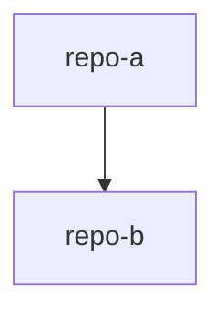

# 项目群 RULE.mdc 模板

````markdown
# {项目群名称} - 项目群知识索引

<!-- AI生成，可根据团队规范更新 -->

## 项目群定位

{一句话描述项目群和仓库协作目标}

## 生成信息

- 生成时间：{YYYY-MM-DD HH:mm:ss}
- 子仓库快照：
  - {repo-name}: {branch} ({commit-short})

## 子仓库清单

| 仓库 | 职责 | 技术栈 | 路径 |
| --- | --- | --- | --- |
| {repo-name} | {职责} | {技术栈} | {相对路径} |

## 仓库关系图



## 快速导航

| 文档 | 说明 | 状态 |
| --- | --- | --- |
| [项目群总览](./项目群总览.mdc) | 仓库职责与关系 | [ ] |
| [系统拓扑](./系统拓扑.mdc) | 调用关系与数据流 | [ ] |
| [接口契约](./接口契约.mdc) | 跨仓库接口和共享类型 | [ ] |
| [变更影响](./变更影响.mdc) | 变更传播范围 | [ ] |
| [联调指南](./联调指南.mdc) | 多仓库启动和联调 | [ ] |

## 缺失资料

<!-- TODO: 待补充 -->
````
